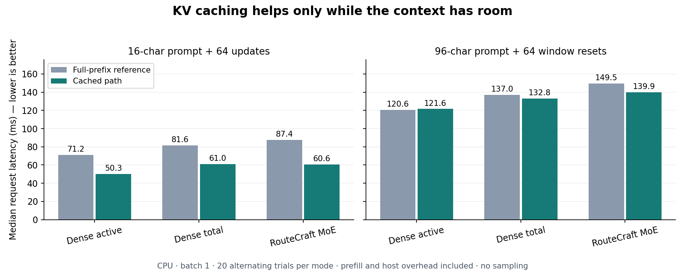
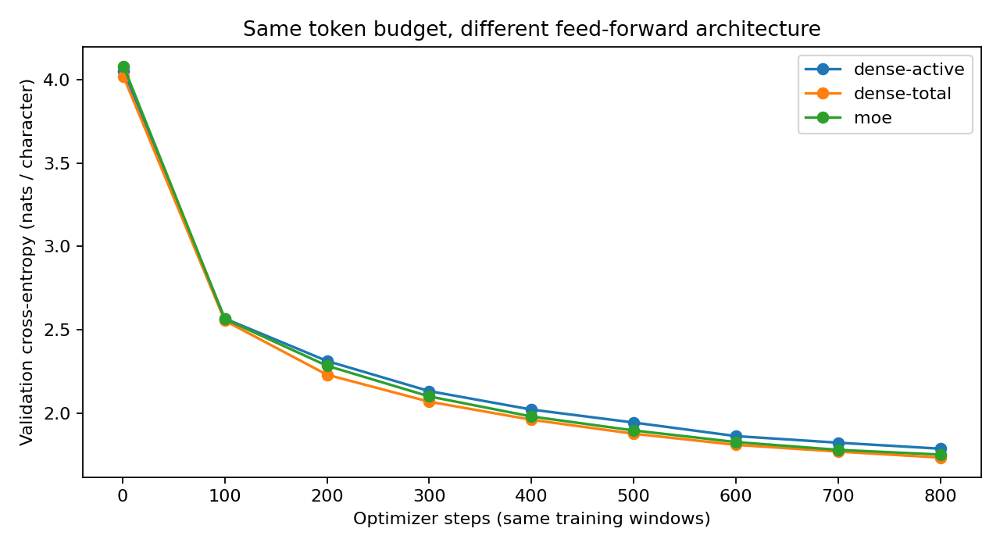
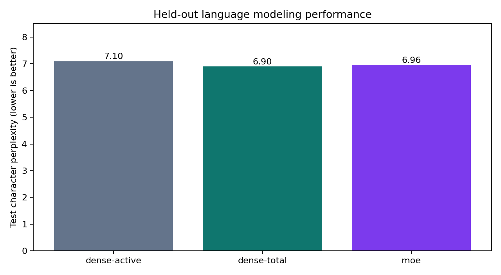
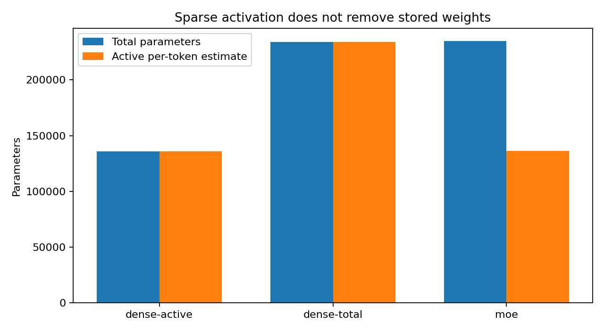
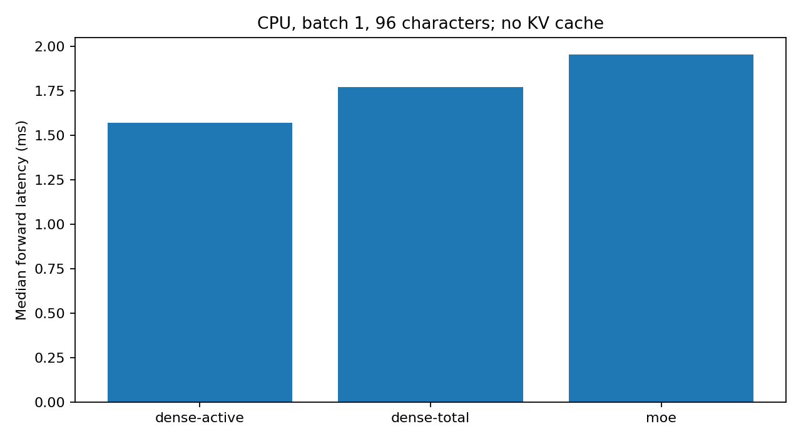
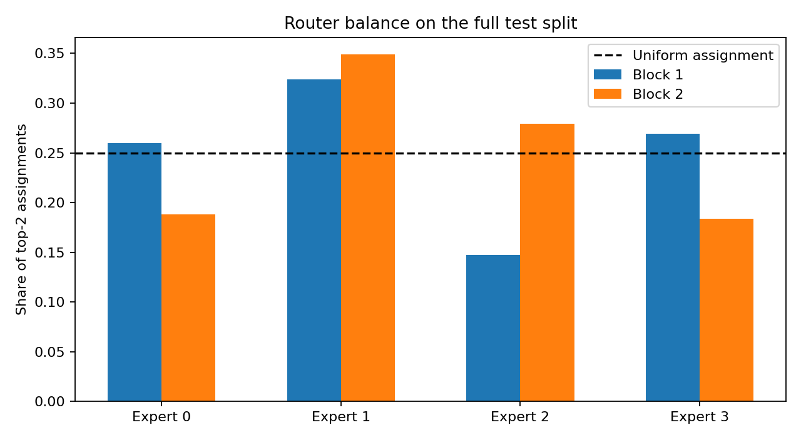
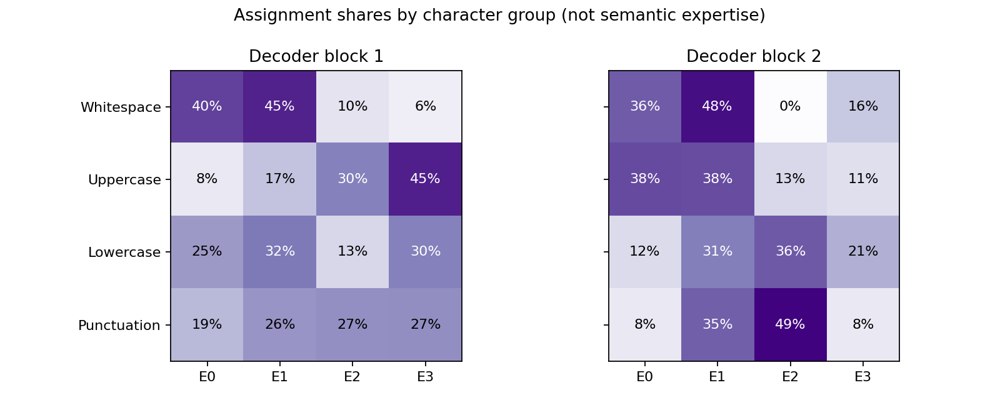

# توجيه الخبراء في نموذج لغوي

نموذج لغوي صغير مبني من الصفر باستخدام TensorFlow لجعل التوجيه المتناثر قابلًا للفحص.

تتضمن البنية كتلتين قبل التطبيع، وأربعة رؤوس انتباه، وعرضًا 64، وسياقًا من 96 محرفًا، وتضمينًا دورانيًا. يوجد أربعة خبراء، ويختار الموجّه خبيرين لكل رمز. لا تُسقط الرموز ولا يوجد حد سعة للخبير.

قورنت نسختان كثيفتان، إحداهما تقارب عدد المعاملات النشطة والأخرى تقارب الإجمالي. تلقت كل بنية 1,228,800 هدف محرف مأخوذًا بالعينة، بالبذرة 42 وخلال 800 خطوة. اختيرت نقاط الحفظ على التحقق قبل الاختبار.

البيانات من Tiny Shakespeare، بتقسيم متصل 80% للتدريب و10% للتحقق و10% للاختبار، ومفردات من 65 محرفًا مستخلصة من التدريب. لا تعبر النوافذ حدود الأقسام.

حقق النموذج الكثيف المقارب للإجمالي أفضل جودة في هذا التشغيل؛ التوجيه لا يثبت تفوقًا عامًا. تبقى جميع أوزان الخبراء في الذاكرة. قياسات التخزين المؤقت أدناه تخص طلبات على المعالج المركزي، ولا تمثل أداءً رسوميًا أو خدمة إنتاجية.

## النتائج المسجّلة

الأرقام التالية من التنفيذ المحفوظ لهذه النسخة؛ لم تُعَد التجارب أثناء تعريب التوثيق.

### النتائج المقاسة

| النموذج | إجمالي المعاملات | تقدير المعاملات النشطة لكل رمز | NLL للتحقق | حيرة الاختبار | دقة المحرف التالي في الاختبار |
| :--- | ---: | ---: | ---: | ---: | ---: |
| كثيف مماثل للمعاملات النشطة | 135,872 | 135,872 | 1.8448 | 7.0968 | 43.65% |
| كثيف مماثل لإجمالي المعاملات | 234,176 | 234,176 | **1.7944** | **6.9003** | **44.07%** |
| RouteCraft MoE | 234,688 | 136,384 | 1.8113 | 6.9610 | 43.52% |

### هندسة الاستدلال وتخزين المفاتيح والقيم

| النموذج | مرجع إعادة حساب البادئة | المسار ذو التخزين المؤقت | المرجع ÷ التخزين المؤقت |
| :--- | ---: | ---: | ---: |
| كثيف مماثل للمعاملات النشطة | 71.24 ms | 50.30 ms | 1.42× |
| كثيف مماثل لإجمالي المعاملات | 81.61 ms | 61.03 ms | 1.34× |
| RouteCraft MoE | 87.44 ms | **60.64 ms** | **1.44×** |

## الرسوم والنتائج المرئية

الرسوم محفوظة من التنفيذ الأصلي. تعريب هذه الصفحة لا يغيّر بياناتها أو تسميات الصور داخل الملفات.

## الملفات المرجعية

- [درجات التنفيذ المحفوظة](runs/metrics.json).
- [مرجع البيانات وبصماتها وحدود التقسيم](data/manifest.json).
- [تفاصيل استخدام الأداة](USAGE.md).

## المصادر والإسناد

- [مصدر 1: Tiny Shakespeare](https://github.com/karpathy/char-rnn/blob/6f9487a6fe5b420b7ca9afb0d7c078e37c1d1b4e/data/tinyshakespeare/input.txt).
- [مصدر 2: Switch Transformers](https://www.jmlr.org/papers/v23/21-0998.html).
- [مصدر 3: RoFormer](https://arxiv.org/abs/2104.09864).
- [مصدر 4: GLU Variants Improve Transformer](https://arxiv.org/abs/2002.05202).
- [مصدر 5: TensorFlow function guide](https://www.tensorflow.org/guide/function).

[المرجع التقني الإنجليزي الكامل](README.en.md) يحفظ تفاصيل النسخة الأصلية. تُترك أسماء الملفات والأوامر ومعرّفات النماذج والمقاييس بصيغتها التقنية لضمان تطابقها مع الكود.
